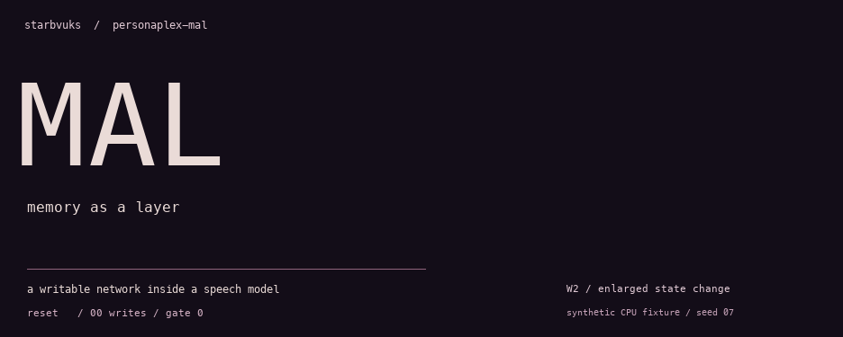
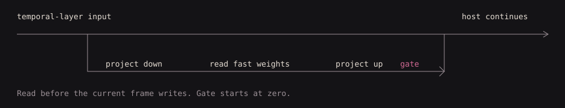
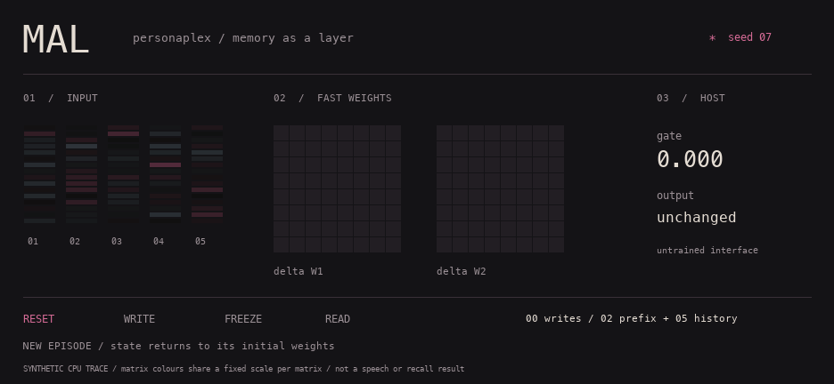

<picture>
  <source media="(prefers-reduced-motion: reduce)" srcset="assets/signal-still.png">
  
</picture>

I want a speech model that can carry something forward after its immediate context runs out. This is the memory experiment: a small writable network attached to PersonaPlex’s Moshi transformer.

The host stays frozen. The memory updates its own weights at test time. Its episode state can be frozen, saved and restored separately from the backbone.

[Run it](#run-it) · [Inside the branch](#inside-the-branch) · [What would count as recall?](#what-would-count-as-recall)

## Run it

```sh
python -m venv .venv
source .venv/bin/activate
pip install -e '.[dev]'
python examples/episode.py
pytest -q
```

CPU, synthetic hidden states, no model download. The example checks zero-gate identity and a frozen-state checkpoint round-trip.

## Inside the branch



The memory is a two-layer SiLU MLP. A write takes a reconstruction-error gradient step with momentum and forgetting. A read goes back through a residual gate initialized to zero, so adding the untrained branch initially leaves the host output unchanged. The interface still needs training.

| File | What's in it |
| :--- | :--- |
| [`mal.py`](mal.py) | Fast weights, temporal-layer hooks, episode checkpoints. |
| [`memory_policy.py`](memory_policy.py) | Write controls and bounds on state changes and residuals. |
| [`kv_read.py`](kv_read.py) | Optional sparse-slot attention experiment. Requires compatible Moshi internals. |

<details>
<summary>About the moving image</summary>

The cover is an enlarged, smoothed colour treatment of changes to one fast-weight matrix. It is generated from the public CPU fixture, not recorded speech. For the measured view:

<picture>
  <source media="(prefers-reduced-motion: reduce)" srcset="assets/memory-still.png">
  
</picture>

Five 16-dimensional history frames feed an 8-dimensional memory branch. Two prefix writes plus five history writes make seven updates. The two squares show changes from the initial weight matrices; each uses its own fixed colour scale throughout the sequence. Pink is positive, blue-grey negative.

The last two query frames read frozen state. Its hash stays unchanged. The gate remains zero throughout: changing memory weights does **not** demonstrate a useful effect on the host. The loop explicitly resets for a new episode.

The underlying values are in [`assets/trace.json`](assets/trace.json). Reduced-motion viewers receive a still frame.

To regenerate the images, install Pillow in the same environment and run `python examples/render_readme.py`. This uses only synthetic tensors; the cover smooths and enlarges the matrix for atmosphere. Font rendering may vary by platform.

</details>

## What would count as recall?

The useful question is whether an answer follows the history it was given. That needs matched, swapped and empty histories, plus a gates-off control, on held-out queries. A moving matrix, a changed answer or lower training loss doesn't settle it.

**Useful episodic recall and native speech integration are not established by this release.** The runnable example and tests check mechanisms. [The next evaluation](https://github.com/starbvuks/personaplex-mal/issues/1) is still open.

[Integration notes](docs/integration.md) · [Experiment notes](docs/experiments.md)

---

Independent implementation, adapted from [Titans](https://arxiv.org/abs/2501.00663) and [Titans-as-a-Layer](https://arxiv.org/abs/2606.08573). No claim to their reported results. MIT · [starbvuks](https://github.com/starbvuks)
